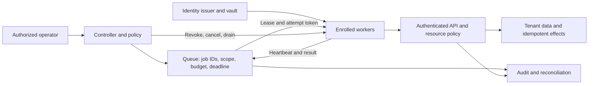

# A precise model

A **bot** is software that automates an interaction or task. A browser bot drives a browser; an API bot calls programmatic interfaces; a chat bot receives and emits messages; a crawler follows links and schedules retrieval. A load-test worker generates a predefined owned-system workload. An AI agent chooses steps using a model and tools. These terms describe behavior, interface or decision mechanism, not permission or intent. A **swarm** is an informal label for multiple cooperating agents/workers; define membership, coordination and shared objective before making claims about one. Parallel independent jobs alone do not establish sophisticated collaboration.

A **fleet** is the operated population of workers/devices. **Coordinated abuse** is harmful joint activity and can use ordinary accounts or automation without compromised devices. A **botnet**, in the malicious security sense used here, is a remotely coordinated network of compromised machines. Legitimate orchestration and compromise are different trust relationships. DOJ's [911 S5 account](https://www.justice.gov/archives/opa/pr/911-s5-botnet-dismantled-and-its-administrator-arrested-coordinated-international-operation) describes alleged malware-backed residential proxy access; that evidence must not be generalized to every proxy service or every automated fleet.

| Entity | What it means | Why it must remain separate |
| --- | --- | --- |
| Operator | Person/organization controlling a workload | One operator may own many principals; an observed IP does not identify them |
| Agent | Logical decision-making participant | It may restart in another process or delegate several workers |
| Process/worker | Runtime execution unit / job consumer | Multiple workers may share one service account, host and egress |
| Job/attempt | Desired operation / one execution try | A retry is another attempt, not necessarily another authorized effect |
| Account/principal | Server-recognized authorization identity | Assigns permissions; not established by a cookie jar label |
| Session | Bounded authenticated interaction state | An account can have multiple sessions; logout/expiry/revocation differ |
| Browser context | Isolated browser state container | Does not automatically create another physical device or network identity |
| Device | Host or enrolled client endpoint | Can run several contexts, accounts and processes |
| IP address | Address observed at a network hop at a time | NAT can combine clients; allocation/failover can change an address |

[Playwright's isolation documentation](https://playwright.dev/docs/browser-contexts) describes isolated cookies and web storage. Inferring a distinct device or person from a context goes beyond that contract. [Kubernetes service accounts](https://kubernetes.io/docs/concepts/security/service-accounts/) provide workload identities and can be bound to minimum roles; they are not human accounts.

## Legitimate construction and control

This is a design synthesis, not an existing NBRET subsystem. Establish an issuer/root of trust before enrollment; verify workload identity rather than accepting a worker-supplied name. Controller policy assigns scoped jobs, short-lived secret references, permitted resources and budgets. A queue holds durable intent; a lease grants temporary processing rights. Heartbeat loss is uncertainty about liveness, not proof the old process stopped. Use a new attempt token when reassigning and reject stale result commits. Resource-side idempotency or fencing is still needed when an earlier worker can perform an external effect before losing its lease. Deduplicating queue insertion alone cannot undo that effect.

Bound retries, back off transient failures, add bounded jitter, and distinguish retryable failures from denied authorization and permanent input errors. Persist results/checkpoints under job, tenant and policy version. Rate budgets should cover worker concurrency, tenant/principal demand and total downstream capacity. Log assignment, attempt, lease, policy, principal and effect IDs without storing credentials. Stage authenticated updates, restrict secret exposure and revoke issuer/broker/resource permissions when a worker is removed. A kill switch must stop new assignment, invalidate authority and request process cancellation; then confirm active work drained, resources closed and effects reconciled. An acknowledged cancellation request is not proof of quiescence.

[Kubernetes Jobs](https://kubernetes.io/docs/concepts/workloads/controllers/job/) document retries, parallelism and deadline controls, including cases where application work must tolerate replacement executions. [Leases](https://kubernetes.io/docs/concepts/architecture/leases/) support heartbeat and leader-election coordination. These establish concrete mechanisms, not a guarantee of exactly-once application effects.

| Coordination | Mechanism and strength | Failure/security question |
| --- | --- | --- |
| Central controller | One logical authority, queue and policy; easy audit and revocation | Controller availability, queue consistency and overloaded dependencies |
| Distributed workers/shared broker | Many consumers claim work atomically; BullMQ lease scripts are a concrete instance | Lost lease, duplicate side effects, broker trust, process-local quotas |
| Replicated controllers | Leader election/reconciliation, e.g. Kubernetes leases | Split decisions, stale ownership and recovery after partitions |
| Peer coordination | Members exchange state without a single work dispatcher; memberlist's pinned suspicion timer is a concrete failure-detection example | Membership authentication, convergence, conflicting effects and revocation; suspected death is not proof of stopped effects |

## Assigning accounts in an owned system

Maintain a mapping `(environment, tenant, principal, worker, session, job, permitted scopes, expiry)` issued by trusted provisioning. Prefer per-workload credentials where attribution/revocation requires it; several workers sharing one account share its authority and often its budget. Use OAuth audiences/scopes with resource-side tenant and object checks. Store secret references in job state and obtain short-lived credentials from a vault/issuer at execution time; do not serialize bearer tokens into logs or model memory. [OAuth security BCP](https://www.rfc-editor.org/rfc/rfc9700.html) covers privilege restriction and token replay protection; scopes alone are not proof that a resource server enforces tenant boundaries.

For tests, provision only synthetic users and tenants through an owned fixture. Isolate cookie jars/browser storage by synthetic principal and preserve that binding on redirects, retries, follow-up requests, cached results and trace exports. A jar key is a local storage selector, not authenticated authorization. Include negative tests: same URL across accounts, shared process, copied metadata, stale session, revoked user, wrong tenant and concurrent use. Treat persisted browser state as credentials. Tear down the fixture and revoke credentials after the run. Scrapy's concrete jar selector is examined in [source notes](source-notes.md).

## What changing an IP actually changes

A client normally uses an address allocated to its interface/network. DHCP/reconnection can change allocations; IPv6 can use temporary addresses to reduce stable address-based tracking ([RFC 8981](https://www.rfc-editor.org/rfc/rfc8981.html)). NAT can present many internal clients through one public address, creating attribution and application problems ([RFC 6269](https://www.rfc-editor.org/rfc/rfc6269.html)). A gateway/VPN/proxy causes a service to observe that intermediary's egress address. Cloud failover or a gateway pool can change which owned egress carries traffic. These are routing/allocation mechanisms; none creates a new authenticated account or grants permission.

Abusive fleets may distribute traffic through compromised endpoints or intermediaries; this explains why an address blacklist cannot identify one operator reliably. We study those architectures and defenders' disruption reports, not operational evasion. The lab changes symbolic address labels only: it never rotates interfaces, acquires proxies, alters routing or sends remote test traffic. Linden's [connectivity study](../toolchain/source-notes.md) covers the network mechanisms separately.
